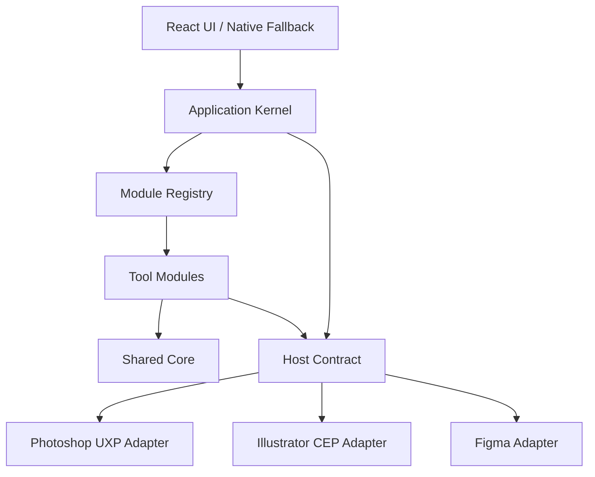

# Toyshop — 跨平台模块化设计工具箱项目规划

**文档版本：** v0.3 Draft
**项目名称：** Toyshop（暂定）
**项目类型：** 跨平台设计软件插件
**目标宿主：** Adobe Photoshop / Adobe Illustrator / Figma Design
**架构参考：** [EIHRTeam/AstMatrix](https://github.com/EIHRTeam/AstMatrix)
**开发方式：** Monorepo / TypeScript / Offline-first
**主要目标平台：** Windows / macOS

---

## 1. 项目概述

### 1.1 项目定位

Toyshop 是一个面向设计师的跨平台、多功能、模块化设计工具箱插件。

项目旨在通过统一的插件界面与模块化功能架构，为 Photoshop、Illustrator 和 Figma 提供高效、易用、可扩展的设计辅助功能，减少重复性操作，提高设计工作效率。

Toyshop 不局限于某一类设计操作，而是作为一个可以持续扩展的工具平台，按功能类别组织独立模块。

项目首个模块为 **Text Case Converter**，用于批量处理设计文档中的英文文本，支持大小写转换，以及实验性的句首大写功能。

### 1.2 核心设计原则

1. **跨平台统一：** 尽可能共享业务逻辑、模块定义、UI 组件及交互规范。
2. **模块化设计：** 每项工具作为独立模块实现，避免模块之间形成强耦合。
3. **宿主能力抽象：** 通过统一 Host Contract 和 Host Adapter 操作设计文档。
4. **兼容性优先：** 支持明确的最低宿主版本，为不同运行时生成兼容构建。
5. **离线优先：** 核心功能完全本地运行，不依赖后端服务。
6. **非破坏性优先：** 尽可能保留文档结构、字体样式、布局属性及可编辑性。
7. **可维护性：** 使用现代 TypeScript 工具链，并配套自动化测试和 CI。
8. **渐进式扩展：** 优先完成稳定的基础架构与首个模块，再逐步扩展工具集。

### 1.3 项目初期非目标

MVP 阶段暂不考虑：

- 第三方远程模块市场及模块在线安装。
- 用户自定义 JavaScript 脚本执行。
- 云端文档同步和用户账户系统。
- AI 驱动的自然语言文本分析。
- 设计文件格式之间的完整互转。
- 在模块之间建立复杂工作流编排系统。
- 超出既定宿主范围的软件适配。

保留相应扩展空间，但不为尚未确定的需求提前引入大量基础设施。

---

## 2. 核心技术栈

### 2.1 技术选型

| 领域           | 选用技术                    |
| -------------- | --------------------------- |
| 开发语言       | TypeScript 7.x              |
| 开发运行时     | Node.js 24 LTS              |
| 包管理器       | pnpm                        |
| Monorepo       | pnpm Workspace              |
| 前端框架       | React 19                    |
| React 编译优化 | React Compiler              |
| Web 构建工具   | Vite 8                      |
| UI 组件体系    | shadcn/ui                   |
| UI 样式        | Tailwind CSS / 宿主兼容 CSS |
| 图标           | Lucide                      |
| 状态管理       | React Context + Hooks       |
| 单元测试       | Vitest                      |
| UI 测试        | React Testing Library       |
| Lint           | Oxlint                      |
| 格式化         | Oxfmt                       |
| CI/CD          | GitHub Actions              |

原则上使用相应技术栈的稳定版本，并通过锁文件保证构建可复现。

不主动引入 Zustand、Redux 等全局状态管理框架。模块局部状态使用 `useState`、`useReducer`，共享状态使用 Context 和自定义 Hooks。

### 2.2 React Compiler

React Compiler 作为共享 React UI 的默认构建能力。

要求：

- 通过构建配置统一启用 React Compiler。
- 遵守 React Hooks 和组件纯度规则。
- 不依赖 React Compiler 优化宿主 API 的调用。
- 支持独立构建 Compiler On / Off 对照版本。
- 对 React Compiler 与旧版 CEP 环境的组合进行实际运行测试。

React Compiler 只作用于 React 组件及相关逻辑，不参与 ExtendScript 或宿主脚本的编译。

### 2.3 shadcn/ui 兼容性

shadcn/ui 作为共享 UI 组件体系及视觉规范基础。

考虑到 Illustrator CEP 11/12 使用较旧的 Chromium，不能直接假设所有最新版 shadcn/ui、Tailwind CSS 4 功能都兼容。

因此采用以下策略：

- 在项目内维护 shadcn/ui 组件源码。
- 统一组件 API、设计令牌和视觉规范。
- 对旧 CEP 使用兼容 CSS 构建。
- 可使用 Tailwind CSS 3.4 或经兼容性转换的 CSS 作为旧宿主样式实现。
- 对现代 Web UI 使用符合对应目标的样式构建。
- 禁止把现代 CSS 特性不经检查地引入 CEP 11。
- React 组件可以共享，但不同宿主允许采用不同 UI 实现或输出。

Photoshop 原生 UXP 回退界面不强制完整复现 shadcn/ui，而是以功能可用和交互一致为优先目标。

---

## 3. 宿主支持边界

宿主架构与版本管理参考 AstMatrix 当前的实现方式，区分：

1. **Host Target：** 插件运行时与宿主适配器。
2. **Web Build Profile：** JavaScript / CSS 编译兼容性目标。
3. **Compatibility Matrix：** 需要实际验证的宿主版本与平台组合。

### 3.1 Adobe Photoshop

**最低版本：Photoshop 26.0+**

采用 Adobe UXP，最低目标运行时为 UXP 8.0。

实现形式：

- UXP 原生插件入口。
- 本地 WebView 加载 React + shadcn/ui 界面。
- WebView 与 UXP Host 之间采用受控消息协议通信。
- 保留 Native UXP UI 作为回退方案。

优先使用 WebView UI；WebView 不可用或消息桥初始化失败时，回退到 Native UXP UI。

Native UI 至少应保留首个模块的核心操作能力，而不只是错误提示。

**注意：** Photoshop 26.0+ 是 Toyshop 的宿主最低版本，不因 AstMatrix Native UXP 原版支持 Photoshop 24.0+ 而自动扩大支持范围。

### 3.2 Adobe Illustrator

**最低版本：Illustrator 27.0+**

采用 CEP + ExtendScript。

| Illustrator 版本   | CEP 运行时 | Web Build Profile |
| ------------------ | ---------- | ----------------- |
| 27.x / 2023        | CEP 11     | `cep11`           |
| 28.x / 2024        | CEP 11     | `cep11`           |
| 29.0–29.5.0 / 2025 | CEP 11     | `cep11`           |
| 29.5.1+ / 2025     | CEP 12     | `cep12`           |
| 30.x / 2026        | CEP 12     | `cep12`           |

采用与 AstMatrix 相同的 Bootstrap 策略：

1. 启动兼容旧 CEP 的轻量 Bootstrap。
2. 通过 CSInterface 获取宿主和 CEP 运行时版本。
3. 验证版本组合是否受支持。
4. 根据运行时选择 `web/cep11` 或 `web/cep12`。
5. 加载对应的 React UI。
6. 使用 ExtendScript 桥接 Illustrator 文档 API。

单个 CEP 扩展包同时包含 CEP 11 和 CEP 12 的构建产物。

相同 Web Profile 的宿主版本共享构建结果，避免为每个 Illustrator 年度版本重复编译相同资源。

Manifest 应使用经过验证的明确版本范围，例如首版以 27.x–30.x 为测试范围。未来的 Illustrator 主版本需要验证后再扩展，而不是直接假定 `27.0+` 表示无限向上兼容。

### 3.3 Figma

支持 Figma Design 插件环境。

采用：

- Figma Plugin API。
- 独立的插件主线程脚本。
- iframe Web UI。
- React 19 + React Compiler + shadcn/ui。
- `documentAccess: "dynamic-page"`。
- 默认无网络访问权限。

Figma Web UI 使用 Vite 8 的：

`build.target = 'baseline-widely-available'`

该约束针对 Web UI 的浏览器能力，而不是 Figma Plugin API 或桌面客户端版本。

项目使用的 CSS 和第三方组件必须另外验证，确保其实际浏览器要求不会超出 Baseline 目标。

Figma 插件主线程必须单独构建，不应将浏览器 DOM 依赖或 React UI 代码直接引入其中。

### 3.4 平台支持

| 平台                | Photoshop            | Illustrator          | Figma                |
| ------------------- | -------------------- | -------------------- | -------------------- |
| macOS Apple Silicon | 支持                 | 支持                 | 支持                 |
| macOS Intel         | 支持                 | 支持                 | 支持                 |
| Windows x64         | 支持                 | 支持                 | 支持                 |
| Windows ARM64       | 依宿主官方可用性验证 | 依宿主官方可用性验证 | 依宿主官方可用性验证 |
| Linux               | 不支持               | 不支持               | 不列入初期验收       |

JavaScript 核心逻辑尽可能保持平台无关。

对于 Windows 安装器，需要按实际安装和宿主路径差异考虑 x64 / ARM64；不应仅因为 CPU 架构不同就重复编译相同的 JavaScript 业务代码。

---

## 4. 总体系统架构

### 4.1 架构模式

采用 **Microkernel + Module Registry + Host Adapter** 架构。

整体划分为六层：

| 层级               | 职责                                     |
| ------------------ | ---------------------------------------- |
| UI Layer           | 工具界面、交互、用户设置                 |
| Application Kernel | 模块生命周期、任务调度、功能入口         |
| Module Layer       | 独立工具模块及业务规则                   |
| Shared Core        | 共享算法、类型、校验、变更计划           |
| Host Contract      | 统一文档操作能力、状态与错误契约         |
| Host Adapter       | Photoshop / Illustrator / Figma 具体实现 |

依赖关系：



业务模块不直接调用宿主 API。

宿主适配器负责将跨平台能力接口映射到具体设计软件。

### 4.2 Module Registry

采用内建模块注册机制。

每个模块声明：

- 唯一模块 ID。
- 名称、描述和版本。
- 功能分类。
- 模块入口。
- 所需宿主能力。
- 实验性状态。
- 可用平台或特性限制。
- 可选配置与 UI 入口。

建议接口：

```ts
interface ToyshopModule {
  id: string;
  version: string;
  name: string;
  category: 'text' | 'layers' | 'document' | 'assets';
  experimental?: boolean;
  requiredCapabilities: string[];
  load: () => Promise<ModuleDefinition>;
}
```

首版模块全部随插件发行，不实现远程模块下载、动态执行及第三方扩展市场。

### 4.3 Host Contract

Host Contract 不应只描述宿主身份，还应描述宿主支持的实际能力。

建议的能力分类：

- `document.read`
- `document.write`
- `selection.read`
- `text.enumerate`
- `text.read`
- `text.write`
- `text.richStyles`
- `history.transaction`
- `document.observe`

具体能力是否可用，应由宿主适配器在运行时声明。

当某项功能不可用时，模块必须能够提供明确原因，不应默默执行不完整的操作。

### 4.4 宿主通信协议

参考 AstMatrix 的版本化 Host Protocol。

至少包括：

- `requestId`
- `protocolVersion`
- `operation`
- `payload`
- `result`
- `error`

消息必须验证来源、操作名称和数据结构。

对于修改文档的操作，还需校验：

- 当前文档 ID。
- 文档状态或版本指纹。
- 目标对象是否仍然存在。
- 操作是否已取消。
- 是否已有冲突任务。
- 是否具备写入权限。

必须防止由于异步 UI 与宿主通信造成操作应用到错误文档或过期选区。

---

## 5. 项目目录结构

建议采用如下 Monorepo：

```text
toyshop/
├── apps/
│   ├── photoshop-uxp/
│   ├── illustrator-cep/
│   ├── figma-plugin/
│   └── playground-web/
│
├── packages/
│   ├── core/
│   │   ├── module-registry/
│   │   ├── task-runner/
│   │   └── errors/
│   │
│   ├── host-contract/
│   ├── host-adapters/
│   │   ├── photoshop-uxp/
│   │   ├── illustrator-cep/
│   │   └── figma-plugin/
│   │
│   ├── modules/
│   │   └── text-case/
│   │       ├── core/
│   │       ├── ui/
│   │       └── tests/
│   │
│   ├── application/
│   ├── ui-react/
│   ├── ui-uxp/
│   └── shared/
│
├── tooling/
│   ├── build-targets/
│   ├── web-profiles/
│   ├── packaging/
│   └── checks/
│
├── tests/
│   ├── conformance/
│   ├── integration/
│   ├── fixtures/
│   └── performance/
│
├── docs/
├── pnpm-workspace.yaml
└── package.json
```

核心算法包不得依赖 React、DOM、UXP、ExtendScript 或 Figma API。

`ui-react` 可依赖共享类型和应用服务，但不得直接操作宿主文档对象。

`ui-uxp` 为 Photoshop 原生面板提供必要的兼容组件。

ExtendScript 代码维持独立的旧 JavaScript 语法兼容流程。

---

## 6. 首个模块：Text Case Converter

### 6.1 模块定位

**模块 ID：** `text.case`
**所属类别：** Text Tools
**目标：** 批量转换设计文档中可安全识别的英文文本大小写，同时尽可能保留原有文档样式与结构。

### 6.2 支持的操作

| 模式     | 英文名称      | 功能                           | 状态         |
| -------- | ------------- | ------------------------------ | ------------ |
| 全大写   | UPPERCASE     | 将目标英文字符转为大写         | Stable       |
| 全小写   | lowercase     | 将目标英文字符转为小写         | Stable       |
| 句首大写 | Sentence case | 句首首字母大写，其余按规则小写 | Experimental |

所有操作应尽可能修改实际文本内容，而非仅通过字体样式改变显示效果。

Figma 的显示型 `textCase` 属性不能直接替代本模块的数据转换逻辑。

### 6.3 操作范围

模块提供以下范围：

**A. Selected Objects（选中对象）**

仅处理当前选中的文字对象，以及选中容器中的文字后代。

支持：

- Text / Text Frame。
- 普通图层。
- Layer Group。
- Frame。
- Group。
- 支持递归访问的嵌套容器。

**B. Current Area（当前页面或画板）**

处理宿主能够明确确定的当前页面、画板或指定区域中的文字。

如果宿主无法可靠提供这一范围，应禁用或明确标记为不支持，不自动将其替换为整个文档。

**C. Entire Document（整个文档）**

遍历当前设计文档中可访问的全部目标文字。

默认使用 Selected Objects 范围。

没有选中对象时，禁止自动扩大为 Entire Document。

### 6.4 对象扫描规则

统一采用以下规则：

1. 获取范围根节点。
2. 递归访问子节点。
3. 收集可编辑文字对象。
4. 根据宿主对象标识去重。
5. 检查可见性、锁定状态与写入能力。
6. 读取文本内容和必要的富文本样式信息。
7. 生成只读变更计划。
8. 预览并提交。

如果同时选中了父 Group 和其中的 Text，目标 Text 只能被处理一次。

默认跳过：

- 锁定文字。
- 隐藏文字。
- 不可编辑对象。
- 栅格化文字。
- 已转曲或轮廓化的文字。
- 无法安全访问的组件实例。
- 缺失必要字体的对象。
- 无法保证格式安全的富文本对象。

允许用户显式选择包含隐藏对象。

对锁定对象不默认提供强制解锁功能。

### 6.5 各宿主的扫描实现

**Photoshop**

- 从 `activeLayers` 获取当前选区。
- 递归遍历图层组及可访问的子对象。
- 识别文字图层。
- 获取文本内容与样式描述。
- 在 `executeAsModal` 中执行文档修改。
- 利用 Photoshop 历史机制聚合操作。

**Illustrator**

- 从 `document.selection` 获取选区。
- 递归遍历 `GroupItem` 等容器。
- 识别 TextFrame。
- 处理 Threaded Text Frames / Story，避免重复修改同一文本。
- 通过 ExtendScript 执行文档操作。
- 分批处理大型文档，减少界面长时间阻塞。

**Figma**

- 从 `figma.currentPage.selection` 获取选区。
- 对 Frame / Group 等容器递归查找 TEXT 节点。
- 使用 `loadFontAsync` 加载需要修改的字体。
- 对混合字体执行相应检查。
- 使用 Plugin API 写回字符内容。
- 全文件扫描遵守动态页面加载规则。

组件实例、文本变量绑定及覆盖属性需要单独定义行为，默认以不破坏组件关系为优先。

---

## 7. 多语种文本处理策略

### 7.1 基本原则

Toyshop 的 Text Case 模块只应转换英文文本，不修改其他语言文字。

需要支持中英、日英、韩英及其他多语言混排。

示例：

| 输入             | UPPERCASE 输出   |
| ---------------- | ---------------- |
| `Hello 世界`     | `HELLO 世界`     |
| `你好 Photoshop` | `你好 PHOTOSHOP` |
| `日本語 English` | `日本語 ENGLISH` |
| `Привет Hello`   | `Привет HELLO`   |
| `Hello Café`     | `HELLO Café`     |

必须特别区分：

- ASCII 拉丁字母识别。
- Unicode 文字系统识别。
- 自然语言意义上的英语识别。

**使用 ASCII 字母不能证明某个词属于英语。**

例如 `HOLA` 和 `MUNDO` 是西班牙语词汇，但字符均属于 ASCII。

因此，MVP 不宣称具备完整的自然语言英语识别能力。

### 7.2 MVP 语言策略

采用 `ascii-latin-safe` 模式。

处理规则：

1. 识别 Unicode Latin Script 连续词段。
2. 仅转换全部由 ASCII `A–Z / a–z` 构成的候选词。
3. 保留包含非 ASCII 拉丁字符或组合附加符号的词。
4. 保留其他文字系统。
5. 保留数字和标点。
6. 不执行 Unicode 规范化。
7. 不使用可能扩大字符长度的通用 Unicode 大小写映射。

例如：

`Hello Café 世界 WORLD`

转换为大写：

`HELLO Café 世界 WORLD`

此策略对混合语言文档相对安全，但对同样由 ASCII 书写的其他语言无法保证不修改。

如未来需要严格的英语语言识别，应作为独立增强功能实现，例如：

- 用户指定明确的处理范围。
- 文本语言标签。
- 词典辅助识别。
- 本地语言识别模型。
- 不确定片段的确认或跳过机制。

不得将未经语言识别的 ASCII 转换结果标记为“已确认全部为英语”。

### 7.3 字符长度与样式保护

MVP 优先使用一对一的 ASCII 字母转换。

例如：

`a → A`
`B → b`

确保输出与输入具有相同的 UTF-16 长度，从而减少对富文本样式偏移的影响。

但字符长度相等不代表宿主会自动保留样式。

宿主适配器仍然必须：

- 检查文本样式范围。
- 尽可能对对应文本范围执行修改。
- 验证字体、字号、颜色、字距和段落格式。
- 保持原有文字对象可编辑。
- 在无法保证样式完整性时跳过并报告。

### 7.4 Sentence case（实验性）

Sentence case 作为独立文本处理引擎。

第一阶段支持：

- 英文句号。
- 问号。
- 感叹号。
- 换行与段落边界。
- 简单的引号、括号处理。

应对以下情况采取保护或警告策略：

- `Mr.`、`Dr.` 等缩写。
- URL 与域名。
- 邮箱地址。
- 版本号和小数。
- 首字母缩写。
- 品牌名称。
- 专有名词。
- 中英文混合句子。

实验性模式不保证语义准确性。

默认要求变更预览，不提供无需确认的大规模自动执行路径。

---

## 8. 文档变更与事务模型

### 8.1 执行流程

所有修改操作采用两阶段模型：

**阶段一：Preview**

- 获取宿主状态。
- 解析处理范围。
- 扫描文本对象。
- 读取文本及样式元数据。
- 执行纯文本转换。
- 生成 Text Change Plan。
- 统计修改数量、无变化数量与跳过原因。
- 显示预览，不修改文档。

**阶段二：Commit**

- 重新校验宿主文档与对象状态。
- 检查 Change Plan 是否过期。
- 验证所需写入能力。
- 进入宿主允许的修改上下文。
- 执行批量修改。
- 记录成功、失败与跳过对象。
- 按宿主能力提交历史操作。
- 返回执行报告。

### 8.2 Change Plan

建议至少包含：

- `documentId`
- `documentRevision` 或状态指纹
- `scope`
- `operation`
- `changes`
- `skipped`
- `warnings`
- `createdAt`

每项变更包含：

- 目标对象标识。
- 原始文本。
- 新文本。
- 文本及样式状态指纹。
- 预期修改范围。

### 8.3 撤销与失败恢复

优先目标是使一次批量操作对应一次可理解的 Undo 操作。

但不应假定三个宿主具有相同的事务语义。

要求：

- Photoshop 使用 UXP Modal / History 机制。
- Figma 使用其插件历史与 Undo 能力。
- Illustrator 必须通过真实宿主测试确认批量撤销行为。
- 发生部分失败时必须明确报告实际修改范围。
- 对支持可靠回滚的宿主实施回滚。
- 不提供无法保证成功的“原子事务”承诺。
- 用户取消操作不得导致后续异步写入继续执行。

---

## 9. UI/UX 规划

### 9.1 主界面结构

Toyshop 使用紧凑的插件侧边栏。

推荐布局：

**顶部**

- Toyshop 品牌。
- 当前宿主状态。
- 设置入口。

**模块目录**

- Text Tools。
- Layer Tools。
- Document Tools。
- Asset Tools。

**模块工作区**

- 当前模块标题。
- 功能说明。
- 操作选项。
- 处理范围。
- 预览。
- 执行按钮。
- 执行反馈。

模块之间采用统一导航和视觉规范。

### 9.2 Text Case 页面

主要交互控件：

1. 转换模式：UPPERCASE / lowercase / Sentence case。
2. 处理范围：Selection / Current Area / Entire Document。
3. 包含隐藏对象开关。
4. 扫描及预览按钮。
5. 修改对象数量统计。
6. 变更预览。
7. 应用按钮。
8. 结果与跳过原因报告。

建议显示：

- 扫描文字对象数量。
- 预计修改数量。
- 无变化数量。
- 跳过数量。
- 警告数量。

### 9.3 交互原则

- 选中对象为默认范围。
- 任何修改前提供明确的处理范围反馈。
- 不支持的功能应禁用并解释原因。
- 实验性功能应具备清晰标记。
- 不允许在运行中反复提交同一操作。
- 大型文档显示操作进度。
- 使用 React 状态驱动界面更新。
- 尽可能匹配宿主深色、浅色主题。
- 使用键盘可访问的表单、按钮和对话框。

### 9.4 Native UXP 回退界面

原生 UXP 回退应提供简化但可工作的 Text Case UI。

最低要求：

- UPPERCASE。
- lowercase。
- Selected Objects。
- Entire Document。
- 基本结果统计。
- 错误反馈。

Sentence case 和高级预览可根据原生 UI 的实际能力决定是否提供。

---

## 10. 构建系统与兼容性 Profile

### 10.1 Web Build Profiles

参考 AstMatrix：

```ts
export const WEB_PROFILES = {
  cep11: {
    target: 'chrome88',
    cssTarget: 'chrome88',
  },

  cep12: {
    target: 'chrome99',
    cssTarget: 'chrome99',
  },

  'uxp-webview': {
    target: 'es2020',
    cssTarget: 'safari15',
  },

  'figma-ui': {
    target: 'baseline-widely-available',
    cssTarget: null,
  },

  'web-playground': {
    target: 'baseline-widely-available',
    cssTarget: null,
  },
} as const;
```

`cssTarget: null` 表示交由 Vite 默认配置处理，不表示禁用 CSS 兼容性验证。

原生 UXP 应单独定义为非浏览器构建目标。

### 10.2 构建要求

- React UI 源码尽可能共享。
- 按 Web Profile 生成独立 JS / CSS。
- Illustrator ExtendScript 单独打包。
- Photoshop UXP 宿主入口与 WebView 分离。
- Figma 插件主线程和 iframe UI 分离。
- 构建去重使用源码、Profile 和构建选项的组合。
- 生产包不得依赖外部 CDN 加载核心资源。
- 每项发行产物保留版本与构建信息。

Vite 的语法降级不代表缺失的浏览器 API 已被补齐，必须独立验证兼容性。

### 10.3 预期分发产物

| 目标           | 产物                           |
| -------------- | ------------------------------ |
| Photoshop      | `.ccx`                         |
| Illustrator    | 签名 `.zxp`                    |
| Figma          | 插件 `manifest.json`、JS、HTML |
| Figma 开发包   | ZIP                            |
| Web Playground | 静态 Web 构建                  |
| Windows 安装器 | Inno .exe                      |

签名、发布、安装包检查与宿主资源验证由 `tooling/packaging` 统一管理。

---

## 11. 测试与质量保障

### 11.1 测试层次

**Unit Tests**

测试纯函数及模块行为，包括：

- 英文大小写转换。
- 多语种混排。
- Unicode 边界。
- Sentence case 规则。
- 对象去重。
- Change Plan 生成。
- 错误类型和输入校验。

**Contract Tests**

使用统一测试用例检查各 Host Adapter 的契约行为。

**Integration Tests**

使用模拟宿主环境测试：

- 选区解析。
- Group 递归。
- 文档切换。
- 异步操作取消。
- 版本校验。
- 消息桥异常。
- 部分失败及回滚。

**Real Host Tests**

在实际 Photoshop、Illustrator、Figma 中验证。

### 11.2 关键测试场景

测试至少覆盖：

- 普通英文文本。
- 中英混排。
- 日英混排。
- 韩英混排。
- 多文字系统混排。
- 带变音符号的拉丁词。
- 无空格混排文字。
- 多段落文本。
- 不同字体与字重。
- 单个文字框内的混合样式。
- 嵌套 Group / Frame。
- 父容器与子对象同时选中。
- 多选对象。
- 空选区。
- 隐藏或锁定对象。
- 无文档状态。
- 缺失字体。
- Illustrator Threaded Text Frames。
- Figma 组件实例及文本覆盖。
- 文档扫描期间切换文件。
- 预览后对象内容变化。
- 批量操作中断。
- Undo / Redo。
- 转换导致文本重新换行或溢出。
- 超大型设计文档。

### 11.3 最低兼容性验收

重点验证：

- Photoshop 26.0 / UXP 8。
- Illustrator 27.x / CEP 11。
- Illustrator 29.5.1+ / CEP 12。
- Illustrator 30.x。
- 当前受支持的 Figma Design 环境。

除最低版本外，还需覆盖近期正式版本，以检测宿主 SDK 行为变化。

Windows 与 macOS 分别测试，并记录 CPU 架构、宿主版本、运行时版本和构建 Profile。

---

## 12. 性能与资源管理

### 12.1 性能目标

初期以交互流畅性、操作稳定性和可取消性为主要目标。

建议建立以下非功能验收指标：

- 普通选区扫描无需明显阻塞插件 UI。
- 文档规模扩大时允许分批扫描与进度反馈。
- 取消操作后不继续产生新的文档修改。
- 同一模块不得并行执行互相冲突的文档写入。
- 相同输入和选区重复扫描应得到一致结果。
- 大文档场景不得无界缓存完整宿主对象树。

具体延迟、吞吐量和内存阈值应在真实宿主基准测试后确定，而不是预先承诺固定数值。

### 12.2 大文档处理

推荐：

- 分批扫描。
- 仅传输必要的文本与元数据。
- 避免通过通信桥传递完整宿主对象。
- 使用纯数据快照与 Change Plan。
- 在允许的情况下采用批处理宿主 API。
- 对高频状态变化实施合并或节流。
- 扫描与修改分阶段执行。
- 设置任务资源上限，避免内存无限增长。

Figma 全文件操作尤其需要考虑动态页面加载的内存和性能影响。

---

## 13. 隐私与安全

Toyshop 默认本地处理用户设计文档。

核心要求：

- 不将用户文档内容上传服务器。
- 不需要用户登录。
- 不依赖远程 API 完成主要功能。
- 不从网络下载并执行模块代码。
- 只申请实际需要的宿主权限。
- 宿主消息通信采用严格的输入校验。
- 避免将文档正文写入普通日志。
- 错误报告默认不包含敏感文本。
- 第三方依赖需要进行许可证与供应链检查。
- 不在发布包中包含密钥或其他开发凭据。

Figma 默认使用无网络域名权限的 Manifest；如果未来某个模块确实需要联网，应单独评估和说明权限变更。

---

## 14. 后续模块规划

Toyshop 初期规划四个模块类别。

### Text Tools

- Text Case Converter。
- 批量查找与替换。
- 文字清理与空白字符规范化。
- 文本格式检查。

### Layer Tools

- 图层批量重命名。
- 图层整理与排序。
- 无用图层检查。
- 图层命名规则检查。

### Document Tools

- 文档信息检查。
- 画板与页面批量操作。
- 文档规范验证。
- 尺寸及布局辅助工具。

### Asset Tools

- 批量导出。
- 文件命名规范化。
- 资源格式辅助转换。
- 资源元数据处理。

上述均属于扩展候选，不纳入 v0.1 的交付范围。

各模块只能依赖必要的 Host Capabilities，并独立声明兼容性。

---

## 15. 开发路线图

### Phase 0 — 基础架构

**目标：建立可运行的跨宿主插件框架。**

交付内容：

- pnpm Monorepo。
- TypeScript 7 / Vite 8。
- React 19 + React Compiler。
- shadcn/ui 基础组件。
- Module Registry。
- Host Contract。
- Host Adapter 基础结构。
- Photoshop UXP 入口及 WebView 桥。
- Illustrator CEP Bootstrap。
- Figma Plugin 入口。
- Web Playground。
- 基础 CI 与 Vitest。

**验收：** 三端均能加载 Toyshop 面板并运行简单的模拟模块，宿主能力检测和消息通信正常。

### Phase 1 — Text Case MVP

**目标：完成稳定的英文大小写转换。**

交付内容：

- UPPERCASE。
- lowercase。
- ASCII Latin Safe 策略。
- Selected Objects。
- Entire Document。
- Group / Frame 递归扫描。
- 文本对象去重。
- 变更预览。
- 文档状态校验。
- 基本撤销与结果报告。

**验收：** 在三端的最低支持宿主版本中，能够对英文及中英混排文字进行安全的批量大小写转换，且不会静默破坏文字样式。

### Phase 2 — 实验性与健壮性完善

**目标：完善特殊文本和异常操作。**

交付内容：

- Sentence case（Experimental）。
- 更完整的混合样式保护。
- Current Area 范围。
- 更多特殊对象处理。
- 大型文档分批执行。
- 执行进度与取消机制。
- 部分失败恢复与详细报告。
- 实际宿主性能基准测试。

**验收：** 复杂文档和异常情况下，模块能够准确反馈处理结果，不产生无提示的数据损坏。

### Phase 3 — 正式发行准备

**目标：形成完整的三端分发流程。**

交付内容：

- Photoshop CCX。
- Illustrator ZXP。
- Figma 插件发布包。
- 构建验证。
- 签名及发布自动化。
- 安装和升级文档。
- 用户文档。
- 隐私政策。
- 兼容性矩阵。
- 发行版本管理。

**验收：** 通过实际宿主测试并完成所需发布审核。

### Phase 4 — 模块扩展

**目标：验证模块化架构的长期可维护性。**

交付内容：

- 第二个独立业务模块。
- 模块列表与分类 UI。
- 模块级设置持久化。
- 模块级功能开关。
- 更完整的模块开发规范。

**验收：** 能够增加新模块，而无需修改现有模块内部实现或重构宿主桥接层。

---

## 16. 主要技术风险

| 风险                                 | 级别 | 应对方案                      |
| ------------------------------------ | ---- | ----------------------------- |
| CEP 11 不兼容现代 CSS                | 高   | 独立 Legacy CSS Profile       |
| 富文本转换造成样式丢失               | 高   | 样式范围校验与安全跳过        |
| 混合语言误判                         | 高   | 保守 ASCII 策略及明确限制     |
| Illustrator 串接文字重复修改         | 中高 | 按 Story 去重                 |
| 组件实例及文本绑定被破坏             | 高   | 能力检测及默认保护            |
| 大文档扫描卡顿                       | 中高 | 分批扫描与内存限制            |
| 宿主批量撤销行为不一致               | 高   | 分宿主事务策略与验收          |
| React Compiler / shadcn 旧环境兼容性 | 中高 | 分 Profile 构建与真实宿主测试 |

首期应优先验证三项风险：

1. Photoshop 26.0 WebView 与 Native UXP 回退是否可靠。
2. Illustrator 27.0 CEP 11 能否稳定运行所选 React UI 及兼容样式。
3. 三个宿主能否在混合富文本样式条件下安全修改实际字符内容。

这些结论应先于 UI 大规模开发和功能扩展。

---

## 17. v0.1 MVP 最终验收标准

首版至少满足：

- [ ] Photoshop 26.0+ 能正常启动。
- [ ] Illustrator 27.0+ 能通过 CEP 11/12 对应构建启动。
- [ ] Figma Design 能正常加载插件。
- [ ] React 19、React Compiler、shadcn/ui 的对应宿主构建通过兼容性验证。
- [ ] 支持 UPPERCASE 和 lowercase。
- [ ] Sentence case 以实验性功能提供，或在正式启用前保持独立功能开关。
- [ ] 默认仅处理当前选中对象。
- [ ] 支持文字框、图层、Frame 和 Group 的递归处理。
- [ ] 支持整个文档处理。
- [ ] 选中父子对象时不会重复修改。
- [ ] 保留中文、日文、韩文及其他非目标文字。
- [ ] 对 ASCII 英语识别的局限在文档中提供明确说明。
- [ ] 保留可编辑文本与原有样式；不安全对象明确跳过。
- [ ] 修改前可以预览变更数量与内容。
- [ ] 文档或选区发生变化时不会提交过期计划。
- [ ] 支持宿主允许的撤销与失败恢复。
- [ ] 通过单元测试、Host Contract 测试和真实宿主集成测试。
- [ ] CI 能生成对应宿主的构建产物。
- [ ] 核心功能无需联网。

---

## 18. 项目最终技术决策

Toyshop 应采用与 AstMatrix 相近的跨平台架构，但在其基础上强化模块注册、文档选择范围抽象、通用文本操作和批量修改能力。

**确定的核心技术栈：**

pnpm + TypeScript 7 + Vite 8 + React 19 + React Compiler + shadcn/ui。

**确定的宿主技术路线：**

- Photoshop 26.0+：UXP 8+、WebView 优先、Native UI 回退。
- Illustrator 27.0+：CEP 11/12，按实际运行时选择独立 Web Build Profile。
- Figma：Plugin API + iframe UI，Web 构建采用 MDN Baseline Widely Available。

**确定的产品架构：**

Microkernel + Module Registry + Host Contract + Host Adapter + Shared Core。

**确定的首个业务模块：**

Text Case Converter，支持英文大小写转换、混合文字保护、选中容器递归处理及整文档操作，并将 Sentence case 作为实验性功能。

**项目成功的核心标准：**

新增一个模块时，应能直接复用既有 UI 基础设施、宿主能力接口、选择范围解析、任务调度和错误处理机制，而无需为 Photoshop、Illustrator 与 Figma 分别重写完整业务逻辑。

Toyshop 应优先发展为一套稳定、可扩展、具有统一交互体验的设计工具平台，而非多个独立脚本功能的简单集合。

---

## 参考实现

- AstMatrix 仓库：[https://github.com/EIHRTeam/AstMatrix](https://github.com/EIHRTeam/AstMatrix)
- Host Target 定义：`tooling/build-targets/targets.ts`
- Web Profile 定义：`tooling/web-profiles/index.ts`
- Illustrator Bootstrap：`apps/illustrator-cep/bootstrap/index.js`
- Photoshop UXP / WebView：`apps/photoshop-uxp/`
- Figma 插件入口：`apps/figma-plugin/`
- Host Contract：`packages/host-contract/`

以上参考路径基于 AstMatrix 当前 `main` 分支。Toyshop 在项目初始化阶段可借鉴对应实现，但应使用独立的软件包命名空间、插件标识、Manifest 和版本管理体系。
